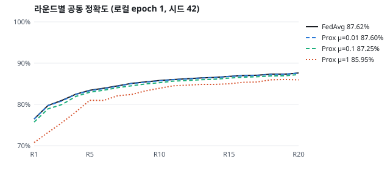
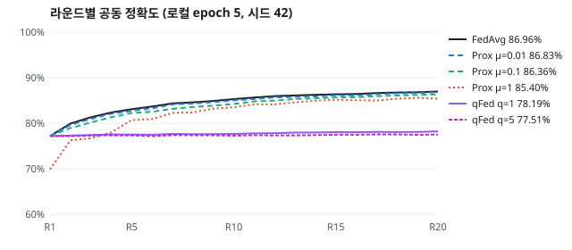
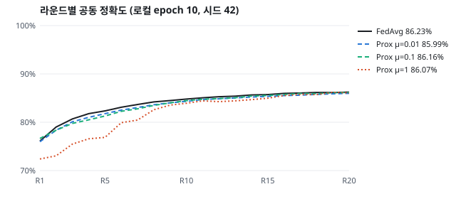

# 심화 6.A 알고리즘 비교: FedAvg · FedProx (담당 A 이건)

> 표·그래프(`<!-- auto:… -->` 구간)는 `python -m scripts.compare_algorithms --seeds 42 7 123 --epochs 1 5 10 --report` 가 자동으로 채움. 그 밖의 글은 사람이 씀.

## 1. 목적과 조건

명세 심화 목표: "동일한 단일 중앙 집계 구조에서 FedAvg·FedProx를 비교하고, 여력이 있으면 q-FedAvg를 추가".

- **구조**: 명세의 "기존 중앙 집계 구조" = 엣지 단계 없이 중앙 S 1개가 클라 6개를 표본 수 가중 평균. Flask 서버 없이 한 프로세스에서 실행 (`scripts/compare_algorithms.py`)
- **같게 둔 것**: 숫자별 분할 방식(C1·C4 = 0~2, C2·C5 = 3~5, C3·C6 = 6~9, 클라당 1,200장), 초기 모델(0), 학습률 0.1, 배치 32, 라운드 20, 6클라 전원 참여, 클라 학습 seed(`client_seed`)
- **바꾼 것**: 알고리즘(FedAvg / FedProx μ = 0.01, 0.1, 1), 로컬 epoch(1 = 기본 설정, 5·10 = 클라 쏠림을 키운 조건), 시드(42, 7, 123 — 시드가 바뀌면 같은 규칙 안에서 클라가 받는 이미지도 바뀜)
- **FedProx**: 로컬 학습 때 `μ·(w − w_global)`를 기울기에 더해 클라 모델이 공동 모델에서 멀어지지 않게 함 (원본 `pgd.py`). 집계는 FedAvg와 같음
- **지표**: 공동 모델 최종 정확도·손실, 최저 숫자 정확도, 하락 라운드 수(직전보다 정확도가 떨어진 라운드), 클라 정확도 최솟값(학습 직후 클라 모델 중 가장 낮은 시험 정확도), 평균 변화량(‖클라 모델 − 공동 모델‖ 평균)
- **구현 검사**: μ = 0이면 FedAvg와 비트 단위로 같음 (`tests/test_learning.py` `test_fedprox`). 단일 중앙 FedAvg(epoch 1, 시드 42) = 0.8762 · 0.4757 로 필수 실험(엣지 2단계)과 같음 → 표본 수 가중 평균에서는 엣지 유무와 상관없이 공동 모델이 같다는 `report.md` 6절과 일치

## 2. 결과 요약

<!-- auto:algo_summary -->
시드 7, 42, 123 · 라운드 20 · 단일 중앙 집계. 값 = 시드 평균 (최소~최대).

| 로컬 epoch | 알고리즘 | 최종 정확도 | 최종 손실 | 최저 숫자 정확도 | 하락 라운드 수 | 클라 정확도 최솟값 | 평균 변화량 |
|---|---|---|---|---|---|---|---|
| 1 | FedAvg | 0.8773 (0.8760~0.8797) | 0.4725 (0.4700~0.4757) | 0.7341 (0.7146~0.7628) | 0.7 (0.0~1.0) | 0.5037 (0.4973~0.5101) | 1.0624 (1.0567~1.0686) |
| 1 | FedProx μ=0.01 | 0.8770 (0.8760~0.8790) | 0.4748 (0.4724~0.4780) | 0.7341 (0.7156~0.7628) | 0.3 (0.0~1.0) | 0.5058 (0.4993~0.5126) | 1.0476 (1.0421~1.0537) |
| 1 | FedProx μ=0.1 | 0.8738 (0.8725~0.8752) | 0.4954 (0.4931~0.4990) | 0.7334 (0.7197~0.7598) | 0.7 (0.0~1.0) | 0.5217 (0.5158~0.5257) | 0.9345 (0.9297~0.9398) |
| 1 | FedProx μ=1 | 0.8585 (0.8567~0.8595) | 0.6529 (0.6516~0.6554) | 0.7077 (0.7023~0.7146) | 1.0 (0.0~2.0) | 0.5756 (0.5680~0.5798) | 0.5560 (0.5537~0.5590) |
| 5 | FedAvg | 0.8726 (0.8696~0.8742) | 0.4305 (0.4213~0.4376) | 0.7283 (0.7166~0.7485) | 0.3 (0.0~1.0) | 0.3967 (0.3831~0.4039) | 1.6441 (1.6329~1.6568) |
| 5 | FedProx μ=0.01 | 0.8711 (0.8683~0.8725) | 0.4370 (0.4280~0.4442) | 0.7296 (0.7146~0.7515) | 0.7 (0.0~1.0) | 0.4191 (0.4057~0.4278) | 1.5317 (1.5216~1.5433) |
| 5 | FedProx μ=0.1 | 0.8667 (0.8636~0.8687) | 0.4766 (0.4707~0.4824) | 0.7207 (0.7064~0.7444) | 0.3 (0.0~1.0) | 0.5055 (0.4941~0.5153) | 1.0632 (1.0575~1.0710) |
| 5 | FedProx μ=1 | 0.8561 (0.8534~0.8609) | 0.6540 (0.6509~0.6598) | 0.6721 (0.6211~0.7156) | 2.7 (0.0~4.0) | 0.5900 (0.5843~0.5948) | 0.5555 (0.5529~0.5589) |
| 10 | FedAvg | 0.8666 (0.8623~0.8703) | 0.4325 (0.4192~0.4422) | 0.7450 (0.7351~0.7526) | 0.7 (0.0~1.0) | 0.3472 (0.3391~0.3594) | 1.9926 (1.9794~2.0071) |
| 10 | FedProx μ=0.01 | 0.8639 (0.8599~0.8668) | 0.4417 (0.4283~0.4515) | 0.7450 (0.7310~0.7526) | 0.0 (0.0~0.0) | 0.3875 (0.3770~0.4015) | 1.7432 (1.7323~1.7555) |
| 10 | FedProx μ=0.1 | 0.8657 (0.8616~0.8678) | 0.4751 (0.4681~0.4814) | 0.7447 (0.7300~0.7526) | 1.0 (1.0~1.0) | 0.5042 (0.4976~0.5090) | 1.0734 (1.0681~1.0806) |
| 10 | FedProx μ=1 | 0.8601 (0.8574~0.8622) | 0.6507 (0.6492~0.6529) | 0.7290 (0.7166~0.7454) | 2.7 (2.0~3.0) | 0.5969 (0.5926~0.6019) | 0.5560 (0.5541~0.5585) |
<!-- /auto:algo_summary -->

## 3. 시드별 결과

<!-- auto:algo_seeds -->
시드별 최종 공동 정확도 (같은 순서가 시드마다 반복되는지 확인).

| 로컬 epoch | 시드 | FedAvg | FedProx μ=0.01 | FedProx μ=0.1 | FedProx μ=1 | 정확도 1위 |
|---|---|---|---|---|---|---|
| 1 | 7 | 0.8760 | 0.8761 | 0.8738 | 0.8567 | FedProx μ=0.01 |
| 1 | 42 | 0.8762 | 0.8760 | 0.8725 | 0.8595 | FedAvg |
| 1 | 123 | 0.8797 | 0.8790 | 0.8752 | 0.8594 | FedAvg |
| 5 | 7 | 0.8739 | 0.8725 | 0.8678 | 0.8534 | FedAvg |
| 5 | 42 | 0.8696 | 0.8683 | 0.8636 | 0.8540 | FedAvg |
| 5 | 123 | 0.8742 | 0.8724 | 0.8687 | 0.8609 | FedAvg |
| 10 | 7 | 0.8703 | 0.8668 | 0.8678 | 0.8574 | FedAvg |
| 10 | 42 | 0.8623 | 0.8599 | 0.8616 | 0.8607 | FedAvg |
| 10 | 123 | 0.8672 | 0.8650 | 0.8676 | 0.8622 | FedProx μ=0.1 |
<!-- /auto:algo_seeds -->

## 4. 라운드별 공동 정확도

<!-- auto:algo_curves -->

<!-- /auto:algo_curves -->

## 5. 해석

**① FedProx는 설계대로 동작했다.** 모든 epoch에서 μ가 클수록 평균 변화량이 줄었다 (epoch 10: 1.99 → 1.74 → 1.07 → 0.56). μ = 1에서는 epoch과 상관없이 약 0.556으로 같아졌다. 근접항이 커서 로컬 학습을 오래 해도 클라 모델이 공동 모델 근처에 묶인 것이다.

**② 클라 쏠림(client drift)은 실제로 있다.** FedAvg에서 로컬 epoch을 1 → 5 → 10으로 늘리면 평균 변화량 1.06 → 1.64 → 1.99, 클라 정확도 최솟값 0.50 → 0.40 → 0.35, 공동 정확도 0.8773 → 0.8726 → 0.8666. 클라마다 숫자 3~4종만 갖고 있어서, 오래 학습할수록 자기 숫자 쪽으로 치우친 모델을 보낸다. 반면 공동 모델 손실은 epoch 5·10(약 0.43)이 epoch 1(0.47)보다 낮다. 라운드당 학습량이 많아 확률값은 더 잘 맞추지만, 맞힌 장수는 줄었다는 뜻이다.

**③ 이 조건에서는 FedProx가 공동 정확도를 높이지 못했다.** 9개 조합(epoch 3 × 시드 3) 중 7개에서 FedAvg가 1위였다. 나머지 2개(epoch 1 시드 7, epoch 10 시드 123)는 FedProx가 앞섰지만 차이가 0.0001·0.0004로 시험 이미지 1장·4장 수준이다. μ가 클수록 공동 정확도는 내려갔다 (epoch 1: μ = 1에서 −0.019). 근접항이 클라의 학습 진전을 줄이는 대가다.

**④ 다만 쏠림이 커질수록 차이가 줄어든다.** FedAvg − FedProx(μ = 1) 정확도 차이: epoch 1 0.0188 → epoch 5 0.0165 → epoch 10 0.0065. μ = 0.1은 epoch 10에서 차이 0.0009로 거의 같다. 쏠림이 클수록 FedProx가 막아 주는 손해가 커져, 학습량을 줄이는 대가를 일부 상쇄한다. 같은 경향으로 클라 정확도 최솟값은 FedProx가 항상 높다 (epoch 10: 0.35 → 0.60). 각 클라 모델이 극단적으로 자기 숫자만 맞히는 상태가 되지 않는다.

**⑤ μ가 너무 크면 불안정해질 수 있다.** μ = 1에서 하락 라운드 수가 epoch 5·10에서 평균 2.7회로 늘었고, epoch 5에서 최저 숫자 정확도가 0.67(최저 0.62)까지 내려갔다.

**⑥ 왜 FedProx의 이점이 작은가 — 실험 조건.** 우리 기본 조건은 6클라 **전원 참여**, 클라당 **같은 장수**, 학습률 고정이다. 매 라운드 평균에 0~9 모든 숫자가 같은 비율로 들어가므로, 클라마다 반대 방향으로 쏠린 변화가 평균에서 상쇄된다. 그래서 FedAvg의 쏠림 피해가 작고 공동 정확도가 거의 오르내리지 않는다 (하락 라운드 수 평균 1회 이하). 공개 FedProx 코드 원본 실행(`third_party.md`: 클라 1,000개 중 라운드마다 10개 선택, 클라마다 숫자 2종, 로컬 20 epoch)에서는 정확도가 0.766 → 0.405처럼 크게 흔들렸다. 그 조건은 라운드마다 일부 숫자만 평균에 들어가 쏠림이 상쇄되지 않는다. FedProx는 이런 이질적 조건(일부 참여, 클라마다 다른 학습량)을 위해 만든 방법이라, 우리처럼 동기·전원 참여 조건에서는 효과가 작게 나오는 것이 자연스럽다.

**한계.** 시드 3개, 학습률 0.1 한 가지, 20라운드, 전원 참여 조건에서만 비교했다. 일부 참여나 지연 클라(심화 6.B의 `_fault` 같은 조건)에서는 결과가 달라질 수 있다. 시드에 따른 범위(표의 최소~최대)가 알고리즘 간 차이보다 큰 경우(예: epoch 1의 FedAvg와 μ = 0.01)는 차이가 있다고 말하지 않는다.
