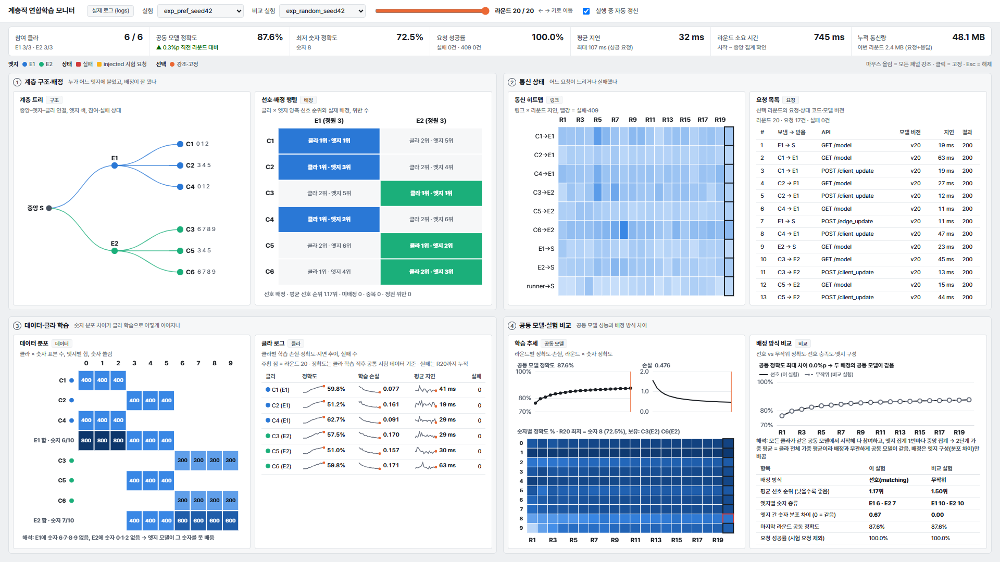
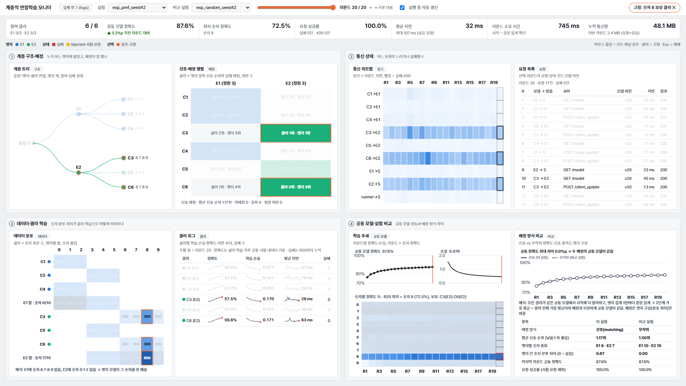
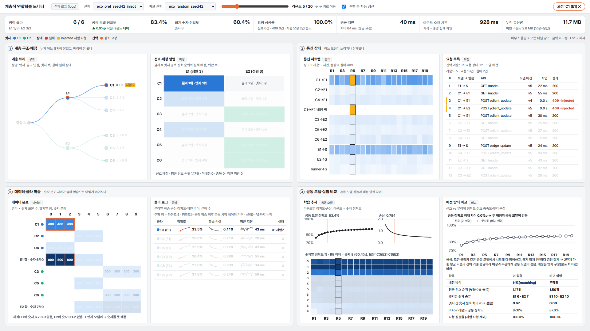

# 모니터링 화면 사용 설명서 (담당 C)

학습·배정·통신 로그를 한 화면(1920×1080)에서 보고, 라운드·클라·엣지·숫자를 골라 모든 패널을 같이 강조한다.



## 1. 실행

```powershell
python -m scripts.run_all            # 실험 3개 → logs/ (약 1분)
python -m dashboard.app              # http://127.0.0.1:5050  (실제 로그)
python -m dashboard.app --sample     # 시험 로그 (dashboard/sample_logs) — 실험 없이 화면만 볼 때
```

- 머리말 왼쪽 칩이 지금 읽는 로그 출처: `실제 로그 (logs)` / `시험 로그 (dashboard/sample_logs)`
- **실행 중 자동 갱신**: 대시보드를 먼저 띄워 두고 `run_all` 을 돌리면 2초마다 새 로그를 받아 라운드를 따라감. 실험이 끝나면 상태 줄이 `실행 끝` 으로 바뀜. 로그가 하나도 없을 때 열어 두면 첫 실험이 생기는 순간 화면이 열림
- 브라우저는 전체 화면(F11) 권장. 1200px 보다 좁으면 영역이 세로로 쌓임

## 2. 머리말 · KPI

| 요소 | 뜻 |
|---|---|
| 실험 / 비교 실험 | 보는 실험, ④ 배정 비교에 같이 그릴 실험 (처음엔 배정 방식이 다른 실험) |
| 라운드 슬라이더 | 모든 패널을 그 라운드로. 키보드 ←/→ 로도 이동 |
| 고정 칩 | 클릭으로 고정한 대상 (예: `고정: E1 + 소속 클라 3`). 칩 클릭 또는 Esc 로 해제 |

KPI 는 선택 라운드 기준.

| KPI | 계산 |
|---|---|
| 참여 클라 | 그 라운드에 학습 기록이 있는 클라 수 / 배정된 클라 수 (엣지별) |
| 공동 모델 정확도 | 중앙 2차 집계 뒤 공통 시험 데이터 정확도, 아래는 직전 라운드 대비 |
| 최저 숫자 정확도 | 숫자 0~9 중 가장 낮은 정확도와 그 숫자 |
| 요청 성공률 | 측정 요청 중 200 응답 비율. **일부러 넣은 시험 요청(injected)은 빼고** 따로 표시 |
| 평균 지연 | 성공한 측정 요청의 요청~응답 시간 평균, 아래는 최댓값 |
| 라운드 소요 시간 | 라운드 시작 ~ 중앙 집계 확인 |
| 누적 통신량 | 라운드 1부터 선택 라운드까지 요청+응답 바이트 |

## 3. 연동 규칙

| 동작 | 결과 |
|---|---|
| 마우스 올림 | 모든 패널에서 같은 대상을 잠깐 강조 |
| 클릭 | 고정 + 머리말 칩. 같은 것을 다시 클릭하면 해제 |
| Esc / 칩 클릭 | 고정 해제 |

| 고른 대상 | 같이 강조되는 것 |
|---|---|
| 엣지 | 소속 클라, 그 엣지의 통신, 그 클라들이 가진 숫자 |
| 클라 | 담당 엣지, 보유 숫자, 그 클라의 학습 지표·선호 순위·통신 기록 (배정 밖 엣지로 보낸 요청 포함) |
| 숫자 | 그 숫자를 가진 클라와 그 엣지 |

색: 엣지마다 고정 색(E1 파랑 · E2 청록 · E3 보라), 선택은 주황 테두리, 나머지는 흐리게. 빨강 = 실제 실패, 노랑 = 일부러 넣은 시험 요청.

## 4. 패널 읽는 법

| 영역 | 패널 | 보이는 것 | 이렇게 읽음 | 클릭하면 |
|---|---|---|---|---|
| ① | 계층 트리 | 중앙–엣지–클라, 클라 옆 보유 숫자, 그 라운드 실패·시험 요청 수·미참여 | 어느 엣지에 어떤 숫자 조합이 모였나 | 엣지·클라 고정 |
| ① | 선호·배정 행렬 | 칸마다 `클라 n위 · 엣지 m위`, 실제 배정 칸은 엣지 색, 아래 평균 선호 순위·위반 수 | 배정된 칸이 클라에게 몇 순위였나 | 칸·클라 이름 = 클라, 엣지 이름 = 엣지 고정 |
| ② | 통신 히트맵 | 링크(보냄→받음) × 라운드, 칸 = 성공 요청 평균 지연(ms) | 진한 칸 = 느린 링크, 빨강·노랑 칸 = 실패·시험 요청 | 칸 = 그 라운드로 이동 + 보낸 쪽 고정 |
| ② | 요청 목록 | 선택 라운드 요청을 순서대로: API·모델 버전·지연·결과 | 거부된 요청의 상태 코드와 모델 버전 확인 | 줄 = 보낸 쪽 고정 |
| ③ | 데이터 분포 | 클라 × 숫자 표본 수, 엣지 합 줄의 `숫자 n/10`, 아래 해석 한 줄 | 엣지마다 빠진 숫자 → 그 엣지 모델이 못 배우는 숫자 | 칸 = 숫자, 이름 = 클라·엣지 고정 |
| ③ | 클라 로그 | 클라별 정확도·학습 손실·평균 지연 작은 추이선(주황 점 = 선택 라운드), 실패 수 | 어느 클라가 학습이 덜 되나 | 줄 = 클라 고정 |
| ④ | 학습 추세 | 공동 정확도·손실(단위가 달라 나란히), 라운드 × 숫자 정확도, 선택 라운드 최저 숫자와 보유 클라 | 정확도가 늦게 오르는 숫자를 찾음 | 칸 = 그 라운드 + 숫자 고정 |
| ④ | 배정 방식 비교 | 두 실험 공동 정확도 곡선, 최대 차이, 지표 표(다른 값만 굵게), 해석 한 줄 | 배정이 공동 정확도를 바꿨나, 엣지 구성을 바꿨나 | – |

해석 문구(③·④)는 로그 값에서 자동으로 만든다.

## 5. 시연 순서 (명세 '연동' 요구 3가지)

**① 엣지 E1 고정 → 배정과 데이터 치우침** — 트리에서 E1 클릭. 소속 C1·C2·C4 만 남고, 데이터 분포에서 E1 에 숫자 6~9 가 없음이 보임 (선호 배정, 분포 차이 0.67).


**② 숫자별 정확도가 낮은 라운드 → 데이터 분포** — 학습 추세 숫자 히트맵에서 빨간 테두리 칸(최저 숫자 8) 클릭. 숫자 8 을 가진 C3·C6 (E2) 이 강조되고 분포에서 그 숫자를 가진 클라가 둘뿐임을 확인.



**③ 통신 실패 라운드 → 요청·모델 버전** — 실험을 `exp_pref_seed42_inject` 로 바꾸고 통신 히트맵의 노란 칸(라운드 5, C1) 클릭. 요청 목록에 `409 · injected` 2건: 지난 버전 `v4` 제출, 배정 밖 엣지 E2 로 제출. 성공률은 시험 요청을 빼서 100%.



## 6. 검사

```powershell
python -m tests.test_dashboard   # 로그 API 엣지 케이스 · 보고서 생성 · 템플릿
python -m tests.test_ui          # 화면 클릭·키보드·자동 갱신 (playwright 있을 때)
```
