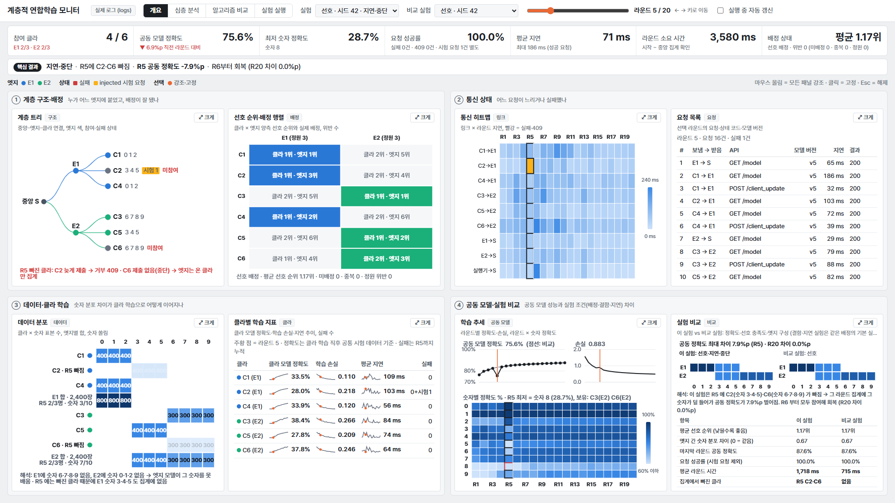
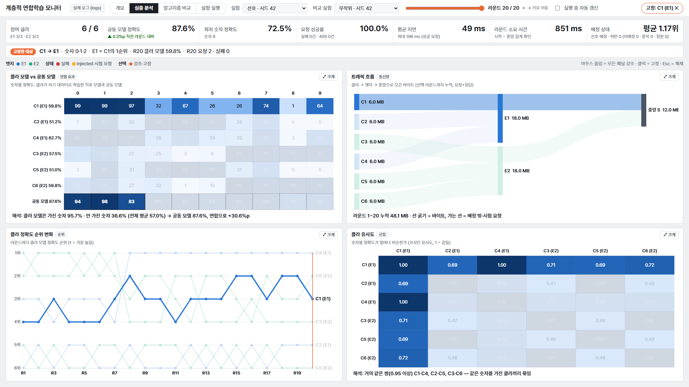
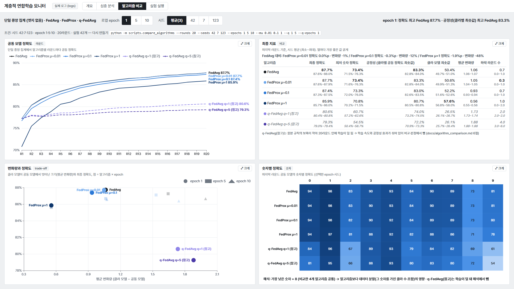
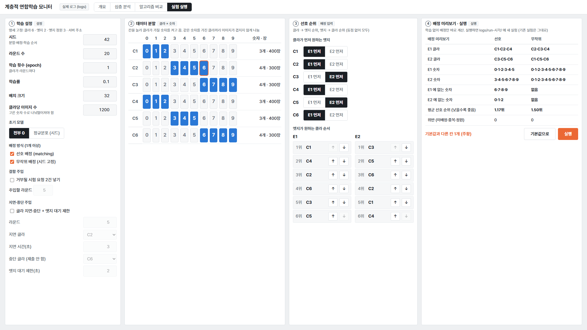
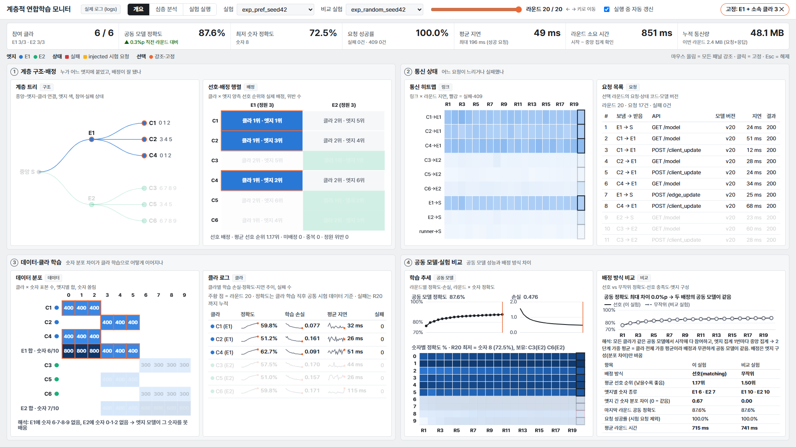

# 모니터링 화면 사용 설명서 (담당 C)

학습·배정·통신 로그를 한 화면(1920×1080)에서 보고, 라운드·클라·엣지·숫자를 골라 모든 패널을 같이 강조한다.


## 1. 실행

```powershell
python -m scripts.run_all            # 실험 3개 → logs/ (약 1분)
python -m dashboard.app              # http://127.0.0.1:5050  (실제 로그)
python -m dashboard.app --sample     # 시험 로그 (dashboard/sample_logs) — 실험 없이 화면만 볼 때
flask --app dashboard.app --debug run --port 5050   # 같은 화면을 flask 명령으로 (수업 방식, --debug 는 개발할 때만)
```

API 오류는 모두 JSON `{"message": "…"}` 와 맞는 상태 코드(400 잘못된 값 · 404 없는 실험 · 409 실행 중 · 415 JSON 아님 · 500 내부 오류)로 온다. 실험 실행 API 는 칸별 표시를 위해 `errors: [{"field", "msg"}]` 를 같이 보낸다.

- 머리말 왼쪽 칩이 지금 읽는 로그 출처: `실제 로그 (logs)` / `시험 로그 (dashboard/sample_logs)`
- **실행 중 자동 갱신**: 대시보드를 먼저 띄워 두고 `run_all` 을 돌리면 2초마다 새 로그를 받아 라운드를 따라감. 실험이 끝나면 상태 줄이 `실행 끝` 으로 바뀜. 로그가 하나도 없을 때 열어 두면 첫 실험이 생기는 순간 화면이 열림
- 브라우저는 전체 화면(F11) 권장. 1200px 보다 좁으면 영역이 세로로 쌓임

## 2. 머리말 · KPI

| 요소 | 뜻 |
|---|---|
| 실험 / 비교 실험 | 보는 실험, ④ 배정 비교에 같이 그릴 실험 (처음엔 배정 방식이 다른 실험) |
| 라운드 슬라이더 | 모든 패널을 그 라운드로. 키보드 ←/→ 로도 이동 |
| 고정 칩 | 클릭으로 고정한 대상 (예: `고정: E1 + 소속 클라 3`). 칩 클릭 또는 Esc 로 해제 |

KPI 는 선택 라운드 기준.

| KPI | 계산 |
|---|---|
| 참여 클라 | 그 라운드에 학습 기록이 있는 클라 수 / 배정된 클라 수 (엣지별) |
| 공동 모델 정확도 | 중앙 2차 집계 뒤 공통 시험 데이터 정확도, 아래는 직전 라운드 대비 |
| 최저 숫자 정확도 | 숫자 0~9 중 가장 낮은 정확도와 그 숫자 |
| 요청 성공률 | 측정 요청 중 200 응답 비율. **일부러 넣은 시험 요청(injected)은 빼고** 따로 표시 |
| 평균 지연 | 성공한 측정 요청의 요청~응답 시간 평균, 아래는 최댓값 |
| 라운드 소요 시간 | 라운드 시작 ~ 중앙 집계 확인 |
| 누적 통신량 | 라운드 1부터 선택 라운드까지 요청+응답 바이트 |

## 3. 연동 규칙

| 동작 | 결과 |
|---|---|
| 마우스 올림 | 모든 패널에서 같은 대상을 잠깐 강조 |
| 클릭 | 고정 + 머리말 칩. 같은 것을 다시 클릭하면 해제 |
| Esc / 칩 클릭 | 고정 해제 |

| 고른 대상 | 같이 강조되는 것 |
|---|---|
| 엣지 | 소속 클라, 그 엣지의 통신, 그 클라들이 가진 숫자 |
| 클라 | 담당 엣지, 보유 숫자, 그 클라의 학습 지표·선호 순위·통신 기록 (배정 밖 엣지로 보낸 요청 포함) |
| 숫자 | 그 숫자를 가진 클라와 그 엣지 |

색: 엣지마다 고정 색(E1 파랑 · E2 청록 · E3 보라), 선택은 주황 테두리, 나머지는 흐리게. 빨강 = 실제 실패, 노랑 = 일부러 넣은 시험 요청.

## 4. 패널 읽는 법

| 영역 | 패널 | 보이는 것 | 이렇게 읽음 | 클릭하면 |
|---|---|---|---|---|
| ① | 계층 트리 | 중앙–엣지–클라, 클라 옆 보유 숫자, 그 라운드 실패·시험 요청 수·미참여 | 어느 엣지에 어떤 숫자 조합이 모였나 | 엣지·클라 고정 |
| ① | 선호·배정 행렬 | 칸마다 `클라 n위 · 엣지 m위`, 실제 배정 칸은 엣지 색, 아래 평균 선호 순위·위반 수 | 배정된 칸이 클라에게 몇 순위였나 | 칸·클라 이름 = 클라, 엣지 이름 = 엣지 고정 |
| ② | 통신 히트맵 | 링크(보냄→받음) × 라운드, 칸 = 성공 요청 평균 지연(ms) | 진한 칸 = 느린 링크, 빨강·노랑 칸 = 실패·시험 요청 | 칸 = 그 라운드로 이동 + 보낸 쪽 고정 |
| ② | 요청 목록 | 선택 라운드 요청을 순서대로: API·모델 버전·지연·결과 | 거부된 요청의 상태 코드와 모델 버전 확인 | 줄 = 보낸 쪽 고정 |
| ③ | 데이터 분포 | 클라 × 숫자 표본 수, 엣지 합 줄의 `숫자 n/10`, 아래 해석 한 줄 | 엣지마다 빠진 숫자 → 그 엣지 모델이 못 배우는 숫자 | 칸 = 숫자, 이름 = 클라·엣지 고정 |
| ③ | 클라 로그 | 클라별 정확도·학습 손실·평균 지연 작은 추이선(주황 점 = 선택 라운드), 실패 수 | 어느 클라가 학습이 덜 되나 | 줄 = 클라 고정 |
| ④ | 학습 추세 | 공동 정확도·손실(단위가 달라 나란히), 라운드 × 숫자 정확도, 선택 라운드 최저 숫자와 보유 클라 | 정확도가 늦게 오르는 숫자를 찾음 | 칸 = 그 라운드 + 숫자 고정 |
| ④ | 실험 비교 | 두 실험 공동 정확도 곡선, 최대 차이, 지표 표(다른 값만 굵게), 해석 한 줄 | 배정이 공동 정확도를 바꿨나, 엣지 구성을 바꿨나 / 결함·지연이 결과를 바꿨나 | – |

**비교 실험 자동 지정**: 결함 주입(`_inject`)·지연·중단(`_fault`) 실험을 고르면 같은 배정의 기본 실험(예: `exp_pref_seed42`)과, 기본 실험을 고르면 배정 방식이 다른 실험(화면에서 돌린 실험은 같은 실행 안에서)과 비교한다. 비교 실험을 직접 고르면 그 뒤로는 자동으로 바꾸지 않는다.

**지연·중단 실험 (`exp_pref_seed42_fault`, 담당 B 심화)**: 해당 라운드(기본 R5)에서 트리의 빠진 클라에 `미참여`, 늦게 낸 클라에 노란 `시험 1`, 트리 아래에 이유 한 줄 — 예: `R5 빠진 클라: C2 늦게 제출 → 거부 409 · C6 제출 없음(중단) → 엣지는 온 클라만 집계`. 참여 클라 KPI 는 `4 / 6 (E1 2/3 · E2 2/3)`, 실험 비교의 최대 차이·해석으로 기본 실험과의 정확도 차이를 본다.



해석 문구(③·④)는 로그 값에서 자동으로 만든다.

## 4-1. 심층 분석 탭

머리말 `개요 | 심층 분석` 으로 전환 (새로고침해도 같은 탭, 주소 끝 `#analysis`). 고정한 대상·라운드는 두 탭이 같이 씀 — 개요에서 C1 을 고정하고 넘어오면 분석 탭에서도 C1 이 강조됨.

| 패널 | 보이는 것 | 이렇게 읽음 |
|---|---|---|
| 클라 모델 vs 공동 모델 | 숫자별 정확도: 클라가 자기 데이터로 학습한 직후 모델 6개 + 공동 모델 | 클라 모델은 가진 숫자는 높고(약 96%) 안 가진 숫자는 낮음(약 37%) → 공동 모델(88%)이 연합 효과 |
| 트래픽 흐름 | 클라 → 엣지 → 중앙 바이트 (선택 라운드까지 누적) | 선 굵기 = 통신량, 가는 선 = 배정 밖·시험 요청 |
| 클라 정확도 순위 변화 | 라운드마다 클라 모델 정확도 순위 | 순위가 자주 바뀌는 클라 / 늘 낮은 클라 |
| 클라 유사도 | 클라끼리 숫자별 정확도 코사인 유사도 | 같은 숫자를 가진 쌍(C1·C4, C2·C5, C3·C6)이 1.00 으로 묶임. 클라를 고정하면 그 클라의 줄·열이 밝아짐 |



## 4-2. 알고리즘 비교 탭 (담당 A 심화 결과)

`python -m scripts.compare_algorithms --seeds 42 7 123 --epochs 1 5 10 --q 1 5 --q-epochs 1` 이 만든 `logs/algo_compare/summary.json` 을 읽기만 한다 (없으면 탭에 이 명령을 안내). 엣지 없이 중앙 1개가 클라 6개를 바로 집계하는 구조에서 FedAvg · FedProx(μ 0.01·0.1·1) · q-FedAvg(q 1·5)를 비교. 위쪽에서 로컬 epoch(1·5·10)와 시드(평균·42·7·123)를 고른다.

| 패널 | 보이는 것 | 이렇게 읽음 |
|---|---|---|
| 공동 모델 정확도 | 라운드별 알고리즘 선 (q-FedAvg 는 점선), 끝에 최종값 | 어느 알고리즘이 빨리·높이 오르나 |
| 최종 지표 | 최종 정확도, 최저 숫자, 클라별 공동 정확도 최솟값(공정성), 클라 모델 최솟값, 평균 변화량, 하락 라운드 — 시드 평균 (최소~최대), 열마다 가장 좋은 값 굵게, 위에 FedAvg 대비 차이 | FedProx μ 를 키울수록 변화량은 줄고 정확도도 조금 줄어듦 |
| 변화량과 정확도 | 점 = 알고리즘 × epoch (모양 = epoch), 선택 epoch 만 진하게 | 클라 모델이 공동 모델에서 덜 벗어나게(왼쪽) 하면 정확도가 어떻게 되나 |
| 숫자별 정확도 | 알고리즘 × 숫자 0~9 (마지막 라운드) | 가장 낮은 숫자가 알고리즘과 상관없이 같으면 → 데이터 분할의 영향 |

알고리즘에 마우스를 올리면 탭 안 4패널에서 같이 강조, 클릭하면 고정 (개요 탭의 고정과는 따로). 해석 문구와 '정확도 최고 · 공정성 최고' 한 줄은 값에서 계산한다. 자세한 해석은 `docs/algorithm_comparison.md` (담당 A).



## 4-3. 실험 실행 탭 (설정 바꿔 학습 돌리기)

머리말 `실험 실행` (주소 `#run`). 명세 구조(클라 6 · 엣지 2 · 정원 3)와 서버 주소는 고정, 나머지를 화면에서 바꿔 바로 학습을 돌린다. 패널 번호 ①→④ 순서로 고르고 ④ 에서 실행. 이 탭에서는 KPI·범례·실험·라운드 컨트롤을 숨김.

| 패널 | 바꾸는 것 |
|---|---|
| 학습 설정 | 시드, 라운드 수, 학습 횟수(epoch), 학습률, 배치 크기, 클라당 이미지 수, 초기 모델(전부 0 / 시드 정규분포), 배정 방식(선호·무작위 중 1개 이상), 결함 주입(켬 + 라운드), **지연·중단 주입**(켬 + 라운드·지연 클라·지연 초·중단 클라·엣지 대기 제한 초, 담당 B `run_all --fault`) |
| 데이터 분할 | 클라 × 숫자 칸을 눌러 켜고 끔. 줄 끝에 `숫자 n개 · 숫자당 장수` (클라당 이미지 수가 숫자 개수로 안 나눠지면 빨강) |
| 선호 순위 | 클라마다 `E1 먼저 / E2 먼저`, 엣지마다 C1~C6 순위를 ↑↓ 로 바꿈 (동점 없음) |
| 배정 미리보기 · 실행 | 값을 바꿀 때마다 학습 없이 두 배정 방식의 결과를 바로 계산: 엣지별 클라·숫자, 없는 숫자, 평균 선호 순위, 위반 수 (두 방식이 다른 칸은 굵게). 지연·중단을 켜면 그 라운드에 엣지마다 실제로 제출하는 클라 (지연 시간이 대기 제한보다 길면 빠짐) |

- **실행**: 서버가 값을 다시 검사 → `logs/run-<연월일-시각>/run_config.json` (예: `run-20261119-130512`) 저장 → `run_all --methods …` 를 그 설정으로 실행 (`HFL_CONFIG`). 새 실험은 `run-<시각>/exp_…` 로 목록 맨 아래에 추가되고, 기존 실험 3개는 그대로
- 첫 실험이 생기면 개요 탭으로 넘어가 실행 중 자동 갱신으로 따라감. 두 방식을 돌리면 두 번째가 비교 실험으로 지정됨
- 한 번에 하나만 실행 (서버 포트가 하나). **중지**는 run_all 과 서버 3개까지 끔, 거기까지의 로그는 남음
- 기본값에서 바꾼 칸은 주황 표시 + `기본값과 다른 칸 n개` (시연 때 무엇을 바꿨는지 바로 보임)
- 잘못된 값은 그 칸·줄을 빨갛게 하고 ④ 에 이유를 한글로 보여 주며 실행 버튼을 막음: 숫자 0개, 숫자 개수로 안 나눠짐, 범위 밖, 배정 방식 없음, **MNIST 장수 초과** (같은 숫자를 가진 클라끼리 겹치지 않게 나누므로 예: 숫자 5 는 5,421장까지)
- 실행 중이면 탭 이름 옆에 주황 점 (●). 실행 기록 칸에 run_all 출력이 바로 보이고, 중지·실패한 실험은 개요에서 `중지함 / 실행 실패 (n라운드까지)` 로 표시 (계속 갱신하지 않음)
- 다른 사이트에서 이 PC 의 실행·중지를 부르지 못하게: 주소는 127.0.0.1·localhost 만, 실행·중지 요청은 JSON 만 받음
- `--sample`(시험 로그) 모드에서는 미리보기만 되고 실행은 막힘 (git 에 있는 시험 로그를 덮어쓰지 않게)



## 5. 시연 순서 (명세 '연동' 요구 3가지)

**① 엣지 E1 고정 → 배정과 데이터 치우침** — 트리에서 E1 클릭. 소속 C1·C2·C4 만 남고, 데이터 분포에서 E1 에 숫자 6~9 가 없음이 보임 (선호 배정, 분포 차이 0.67).



**② 숫자별 정확도가 낮은 라운드 → 데이터 분포** — 학습 추세 숫자 히트맵에서 빨간 테두리 칸(최저 숫자 8) 클릭. 숫자 8 을 가진 C3·C6 (E2) 이 강조되고 분포에서 그 숫자를 가진 클라가 둘뿐임을 확인.


**③ 통신 실패 라운드 → 요청·모델 버전** — 실험을 `exp_pref_seed42_inject` 로 바꾸고 통신 히트맵의 노란 칸(라운드 5, C1) 클릭. 요청 목록에 노란 줄 `409 시험` 2건: 지난 버전 `v4` 제출, 배정 밖 엣지 E2 로 제출. 성공률은 시험 요청을 빼서 100%.


## 6. 검사

```powershell
python -m tests.test_dashboard   # 로그 API 엣지 케이스 · 보고서 생성 · 템플릿 · 실험 실행 API (잘못된 입력 400, 지연·중단 검사, 실제 2라운드 실행, 중지) · 알고리즘 비교 API
python -m tests.test_ui          # 화면 클릭·키보드·자동 갱신·탭·실험 실행 탭·지연·중단 표시·알고리즘 비교 탭·표 잘림 (playwright 있을 때)
python -m unittest               # 위 둘 + 학습(A)·서버(B)·필수 6항목(공동)까지 한 번에 (tests/test_suite.py)
```
