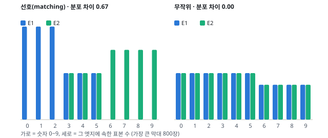

# 배정 방식 비교 보고서 (공동)

> 5.4 초안. 실행 결과 윤효연 / 해석 이건 / 표·그래프 김영헌.
> 표와 그래프는 `python -m scripts.make_report` 가 실제 로그(`logs/`)에서 만들어 `<!-- auto:… -->` 사이에 넣음. 그 사이는 손으로 고치지 말고, 글은 표 밖에 씀.
> 다시 만드는 순서: `python -m scripts.run_all` → `python -m scripts.make_report`

## 1. 실험 조건

데이터 분할·초기 모델·학습 설정은 두 방식 모두 같고, 배정 방식만 다름.

<!-- auto:conditions -->
| 항목 | 값 |
|---|---|
| 시드 | 42 |
| 라운드 | 20 |
| 로컬 epoch | 1 |
| 학습률 | 0.1 |
| 배치 크기 | 32 |
| 클라당 이미지 | 1,200장 |
| 클라별 숫자 | C1: 012, C2: 345, C3: 6789, C4: 012, C5: 345, C6: 6789 |
| 엣지 정원 | 3 |
| 두 실험 학습 조건 동일 | 예 |
<!-- /auto:conditions -->

## 2. 선호 충족도

<!-- auto:preference -->
| 배정 | 실제 배정 | 클라별 배정 엣지의 선호 순위 | 1순위 엣지 받은 클라 | 평균 선호 순위 | 제약 위반 |
|---|---|---|---|---|---|
| 선호(matching) | E1: C1, C2, C4 / E2: C3, C5, C6 | C1=1 C2=1 C3=1 C4=1 C5=1 C6=2 | 5/6 | 1.17 | 0 |
| 무작위 | E1: C2, C3, C4 / E2: C1, C5, C6 | C1=2 C2=1 C3=2 C4=1 C5=1 C6=2 | 3/6 | 1.50 | 0 |
<!-- /auto:preference -->

> (윤효연) 선호 배정 결과 설명: 안정 매칭 결과, 순위 근거

## 3. 엣지별 숫자 분포

<!-- auto:edges -->
| 배정 | 엣지 | 클라 | 표본 수 | 숫자 0~9 표본 수 | 숫자 종류 |
|---|---|---|---|---|---|
| 선호(matching) | E1 | C1, C2, C4 | 3,600 | 800 800 800 400 400 400 0 0 0 0 | 6/10 |
| 선호(matching) | E2 | C3, C5, C6 | 3,600 | 0 0 0 400 400 400 600 600 600 600 | 7/10 |
| 무작위 | E1 | C2, C3, C4 | 3,600 | 400 400 400 400 400 400 300 300 300 300 | 10/10 |
| 무작위 | E2 | C1, C5, C6 | 3,600 | 400 400 400 400 400 400 300 300 300 300 | 10/10 |

엣지 간 숫자 분포 차이 (0 = 같음, 1 = 완전히 다름): 선호 **0.67**, 무작위 **0.00**

<!-- /auto:edges -->

## 4. 학습 성능

<!-- auto:performance -->
| 배정 (라운드 20) | 공동 정확도 | 손실 | 가장 낮은 숫자 정확도 |
|---|---|---|---|
| 선호(matching) | 87.62% | 0.4757 | 72.5% (숫자 8) |
| 무작위 | 87.62% | 0.4757 | 72.5% (숫자 8) |

라운드별 공동 정확도 차이: 최대 **0.0000%p** (라운드 20개 비교)

| 숫자 | 0 | 1 | 2 | 3 | 4 | 5 | 6 | 7 | 8 | 9 |
|---|---|---|---|---|---|---|---|---|---|---|
| 선호(matching) | 93.9 | 98.4 | 83.3 | 89.9 | 92.6 | 84.3 | 90.0 | 89.1 | 72.5 | 80.5 |
| 무작위 | 93.9 | 98.4 | 83.3 | 89.9 | 92.6 | 84.3 | 90.0 | 89.1 | 72.5 | 80.5 |

(숫자별 정확도 %, 마지막 라운드)

<!-- /auto:performance -->

## 5. 통신 기록

<!-- auto:comm -->
| 실험 | 측정 요청 | 성공률 | 실제 실패 | 일부러 넣은 시험 요청 | 평균 지연(ms) | 최대 지연(ms) | 평균 라운드(ms) | 통신량(MB) |
|---|---|---|---|---|---|---|---|---|
| 선호 | 340 | 100.0% | 0 | 0 (409 0) | 32.0 | 106.0 | 621 | 48.1 |
| 무작위 | 340 | 100.0% | 0 | 0 (409 0) | 31.5 | 94.2 | 622 | 48.1 |
| 선호 + 결함 주입 | 340 | 100.0% | 0 | 2 (409 2) | 31.1 | 92.6 | 622 | 48.4 |

성공률·지연은 측정 요청만 셈 (일부러 넣은 시험 요청 제외, 명세 '주입한 시험 기록 구분').
<!-- /auto:comm -->

> (윤효연) 결함 주입 결과 설명: 지난 버전 제출·배정 밖 엣지 제출이 409 로 거부된 것

## 6. 차이 해석

**결론.** 선호 배정과 무작위 배정은 엣지에 모이는 숫자 구성과 선호 충족도는 다르지만, 20라운드 내내 공동 모델이 같았다(공동 정확도 87.62%, 손실 0.4757, 라운드별 차이 최대 0.0000%p). 이 결과는 우연이 아니라 표본 수 가중 평균의 성질로 설명된다.

**1) 무엇이 달랐나.** 배정이 바꾼 것은 어느 클라가 어느 엣지로 묶이느냐뿐이다.
- 선호 배정: E1 = C1, C2, C4 (숫자 6종), E2 = C3, C5, C6 (숫자 7종). 엣지 간 숫자 분포 차이 0.67
- 무작위 배정: E1 = C2, C3, C4, E2 = C1, C5, C6 (둘 다 숫자 10종). 엣지 간 숫자 분포 차이 0.00
- 선호 충족도: 평균 1.17순위(1순위 5/6) 대 1.50순위(3/6). 제약 위반은 둘 다 0

**2) 왜 공동 모델은 같은가.** 클라 i의 모델을 w_i, 표본 수를 n_i라 하자. 엣지 e의 표본 수는 N_e = Σ n_i(엣지 e 소속), 전체는 N = N_E1 + N_E2 = 7,200이다.
- 1차 집계(엣지): w_e = Σ(n_i × w_i) / N_e
- 2차 집계(중앙): w = Σ(N_e × w_e) / N
- 2차 식에 1차 식을 넣으면 N_e가 약분되어 w = Σ(n_i × w_i) / N 이 된다. 클라 6개를 엣지 없이 한 번에 가중 평균한 값과 같다.
- 이 식에는 "어느 클라가 어느 엣지에 있는가"가 들어 있지 않다. 따라서 배정을 바꿔도 클라 모델이 같으면 공동 모델은 같다.
- `docs/aggregation_check.md` 1.4(2단계)와 1.5(6개 한 번에) 손계산에서 같은 값 [2.0, 1.0, 1.0]이 나온다. 이 실험에서는 두 엣지가 모두 3,600장(클라 3 × 1,200)이어서 N_e도 같다.

**3) 20라운드 내내 같은 이유.** 클라는 중앙에서 받은 공동 모델로 학습하고, 학습 seed는 (설정 seed, 라운드, 클라 ID)만으로 정해진다(`client_seed`). 엣지 배정은 seed에 들어가지 않는다. 그래서 1라운드의 공동 모델이 같으면 2라운드의 클라 모델이 같고, 이렇게 20라운드까지 이어진다. 소수점 아래 약 1e-17의 차이는 합산 순서에서 생기는 부동소수점 오차이다(2단계와 1단계 시뮬레이션 비교에서도 같은 크기).

**4) 이 결론이 성립하는 조건.** 클라 6개가 매 라운드 모두 참여하고, 엣지는 평균만 하며(엣지에서 추가 학습 없음), 가중치가 표본 수일 때다. 일부 클라가 빠지거나 엣지에서 따로 학습하거나 가중치가 다르면 배정이 결과에 영향을 줄 수 있다. 결함 주입 실험의 409 2건은 거부된 시험 요청이라 집계에 들어가지 않았고, 그래서 결과가 같다.

**5) 그러면 배정 방식은 의미가 없는가.** 공동 모델 정확도 기준으로는 차이가 없다. 대신 아래는 배정에 따라 달라진다.
- 클라와 엣지의 선호 충족도 (1.17 대 1.50순위)
- 엣지가 받는 데이터의 숫자 구성: 선호 배정의 E1은 숫자 6~9를 전혀 갖지 않는다
- 엣지 서버 하나만 보는 모니터링 값 (엣지별 분포 등)

통신 지연과 라운드 시간은 실행할 때마다 달라지는 측정값이라 배정 효과로 해석하지 않는다.
