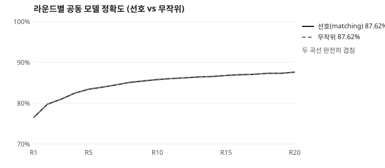

# 배정 방식 비교 보고서 (공동)

> 5.4 초안. 실행 결과 윤효연 / 해석 이건 / 표·그래프 김영헌.
> 표와 그래프는 `python -m scripts.make_report` 가 실제 로그(`logs/`)에서 만들어 `<!-- auto:… -->` 사이에 넣음. 그 사이는 손으로 고치지 말고, 글은 표 밖에 씀.
> 다시 만드는 순서: `python -m scripts.run_all` → `python -m scripts.make_report`

## 1. 실험 조건

데이터 분할·초기 모델·학습 설정은 두 방식 모두 같고, 배정 방식만 다름.

<!-- auto:conditions -->
| 항목 | 값 |
|---|---|
| 시드 | 42 |
| 라운드 | 20 |
| 로컬 epoch | 1 |
| 학습률 | 0.1 |
| 배치 크기 | 32 |
| 클라당 이미지 | 1,200장 |
| 클라별 숫자 | C1: 012, C2: 345, C3: 6789, C4: 012, C5: 345, C6: 6789 |
| 엣지 정원 | 3 |
| 두 실험 학습 조건 동일 | 예 |
<!-- /auto:conditions -->

## 2. 선호 충족도

<!-- auto:preference -->
| 배정 | 실제 배정 | 클라별 배정 엣지의 선호 순위 | 1순위 엣지 받은 클라 | 평균 선호 순위 | 제약 위반 |
|---|---|---|---|---|---|
| 선호(matching) | E1: C1, C2, C4 / E2: C3, C5, C6 | C1=1 C2=1 C3=1 C4=1 C5=1 C6=2 | 5/6 | 1.17 | 0 |
| 무작위 | E1: C2, C3, C4 / E2: C1, C5, C6 | C1=2 C2=1 C3=2 C4=1 C5=1 C6=2 | 3/6 | 1.50 | 0 |
<!-- /auto:preference -->

> (윤효연) 선호 배정 결과 설명: 안정 매칭 결과, 순위 근거

## 3. 엣지별 숫자 분포

<!-- auto:edges -->
| 배정 | 엣지 | 클라 | 표본 수 | 숫자 0~9 표본 수 | 숫자 종류 |
|---|---|---|---|---|---|
| 선호(matching) | E1 | C1, C2, C4 | 3,600 | 800 800 800 400 400 400 0 0 0 0 | 6/10 |
| 선호(matching) | E2 | C3, C5, C6 | 3,600 | 0 0 0 400 400 400 600 600 600 600 | 7/10 |
| 무작위 | E1 | C2, C3, C4 | 3,600 | 400 400 400 400 400 400 300 300 300 300 | 10/10 |
| 무작위 | E2 | C1, C5, C6 | 3,600 | 400 400 400 400 400 400 300 300 300 300 | 10/10 |

엣지 간 숫자 분포 차이 (0 = 같음, 1 = 완전히 다름): 선호 **0.67**, 무작위 **0.00**

<!-- /auto:edges -->

## 4. 학습 성능

<!-- auto:performance -->
| 배정 (라운드 20) | 공동 정확도 | 손실 | 가장 낮은 숫자 정확도 |
|---|---|---|---|
| 선호(matching) | 87.62% | 0.4757 | 72.5% (숫자 8) |
| 무작위 | 87.62% | 0.4757 | 72.5% (숫자 8) |

라운드별 공동 정확도 차이: 최대 **0.0000%p** (라운드 20개 비교)

| 숫자 | 0 | 1 | 2 | 3 | 4 | 5 | 6 | 7 | 8 | 9 |
|---|---|---|---|---|---|---|---|---|---|---|
| 선호(matching) | 93.9 | 98.4 | 83.3 | 89.9 | 92.6 | 84.3 | 90.0 | 89.1 | 72.5 | 80.5 |
| 무작위 | 93.9 | 98.4 | 83.3 | 89.9 | 92.6 | 84.3 | 90.0 | 89.1 | 72.5 | 80.5 |

(숫자별 정확도 %, 마지막 라운드)

<!-- /auto:performance -->

## 5. 통신 기록

<!-- auto:comm -->
| 실험 | 측정 요청 | 성공률 | 실제 실패 | 일부러 넣은 시험 요청 | 평균 지연(ms) | 최대 지연(ms) | 평균 라운드(ms) | 통신량(MB) |
|---|---|---|---|---|---|---|---|---|
| 선호 | 340 | 100.0% | 0 | 0 (409 0) | 39.5 | 200.5 | 910 | 48.1 |
| 무작위 | 340 | 100.0% | 0 | 0 (409 0) | 36.9 | 109.3 | 801 | 48.1 |
| 선호 + 결함 주입 | 340 | 100.0% | 0 | 2 (409 2) | 38.3 | 107.1 | 825 | 48.4 |

성공률·지연은 측정 요청만 셈 (일부러 넣은 시험 요청 제외, 명세 '주입한 시험 기록 구분').
<!-- /auto:comm -->

> (윤효연) 결함 주입 결과 설명: 지난 버전 제출·배정 밖 엣지 제출이 409 로 거부된 것

## 6. 차이 해석

> (이건) 배정이 달라도 공동 정확도가 같은 이유 — 표본 수 가중 평균의 성질 (`docs/aggregation_check.md` 1.5 손계산), 반면 엣지별 숫자 구성은 크게 다름 (3장)
